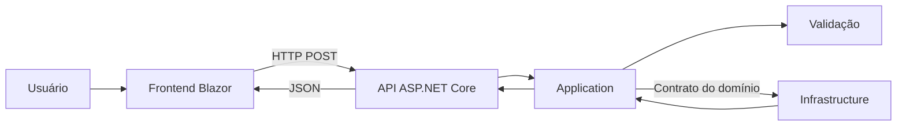

# VVSecurity

**VVSecurity** é um projeto de estudos desenvolvido em **C# e .NET 10**, voltado à geração de senhas e chaves de segurança personalizáveis. A aplicação reúne um frontend em Blazor e uma API REST em ASP.NET Core, com responsabilidades separadas em camadas.

O objetivo é colocar em prática conceitos de desenvolvimento web, segurança, validação de dados, arquitetura de software e publicação de aplicações na nuvem.

## Demonstração online

- **Frontend:** [Acessar VVSecurity](https://vvsecurity-frontend.onrender.com/)
- **Backend:** [https://vvsecurity-api.onrender.com/](https://vvsecurity-api.onrender.com/)

O frontend e o backend são hospedados no Render como serviços independentes, utilizando Docker e HTTPS.

> A hospedagem utiliza o plano gratuito do Render. Após períodos de inatividade, a primeira solicitação pode demorar mais devido à inicialização dos serviços.

## Funcionalidades

- Geração de senhas e chaves aleatórias.
- Comprimento personalizável de **8 a 128 caracteres**.
- Seleção dos tipos de caracteres:
  - Letras maiúsculas (A-Z).
  - Letras minúsculas (a-z).
  - Números (0-9).
  - Símbolos.
- Validação das opções no frontend e no backend.
- Cópia da senha gerada para a área de transferência.
- Interface responsiva com modo claro e escuro.
- Suporte aos idiomas português (PT-BR) e inglês.
- API REST que pode ser consumida por outras aplicações.

## Geração de senhas e segurança

A proposta do gerador é utilizar aleatoriedade criptograficamente segura, disponibilizada pelo .NET por meio de `System.Security.Cryptography.RandomNumberGenerator`, para gerar senhas conforme o comprimento e os conjuntos de caracteres selecionados.

Diferentemente da versão anterior, que descrevia uma chave de tamanho fixo codificada em Base64URL, a versão atual permite personalizar a saída de acordo com as necessidades do usuário.

### Por que utilizar um CSPRNG?

Um **CSPRNG (Cryptographically Secure Pseudo-Random Number Generator)** é um gerador de números pseudoaleatórios projetado para aplicações criptográficas.

- **Imprevisibilidade:** dificulta a previsão dos valores gerados.
- **Aleatoriedade:** permite selecionar caracteres sem depender de identificadores ou sequências previsíveis.
- **Adequação à segurança:** é mais apropriado para gerar segredos do que `System.Random`.

A entropia de uma senha depende do comprimento, do conjunto de caracteres disponíveis e do método de seleção. Por isso, não existe uma quantidade fixa de bits de entropia para todas as configurações.

> Gerar uma senha aleatória não é o mesmo que criptografá-la ou aplicar um hash. O VVSecurity é um gerador de senhas e chaves, não um sistema de autenticação ou armazenamento de credenciais.

## API REST

### Gerar senha ou chave de segurança

**Método:** `POST`

**Endpoint:** `/GenerateSecurityPass/generateSecurityPass`

**URL pública:**

```text
https://vvsecurity-api.onrender.com/GenerateSecurityPass/generateSecurityPass
```

**Content-Type:** `application/json`

### Corpo da requisição

```json
{
  "length": 25,
  "includeUpperCase": true,
  "includeLowerCase": true,
  "includeNumbers": true,
  "includeSymbols": true
}
```

| Propriedade | Tipo | Valor padrão da API | Descrição |
| --- | --- | --- | --- |
| `length` | `int` | `20` | Comprimento da senha, entre 8 e 128 caracteres. |
| `includeUpperCase` | `bool` | `true` | Habilita letras maiúsculas. |
| `includeLowerCase` | `bool` | `true` | Habilita letras minúsculas. |
| `includeNumbers` | `bool` | `true` | Habilita números. |
| `includeSymbols` | `bool` | `true` | Habilita símbolos. |

A interface web inicia com 25 caracteres, enquanto o modelo de requisição da API possui o valor padrão de 20 caracteres.

### Validações

O backend utiliza **FluentValidation** para validar as opções de geração:

- O comprimento deve estar entre 8 e 128 caracteres.
- Pelo menos um tipo de caractere deve estar habilitado.

### Exemplo de resposta — `200 OK`

```json
{
  "securityToken": "aB9@xT2#kL7$pQ4&mZ1!rS6%v"
}
```

O valor acima é apenas ilustrativo e não deve ser utilizado como senha real.

### Status HTTP

| Status | Descrição |
| --- | --- |
| `200 OK` | Geração concluída com sucesso. |
| `400 Bad Request` | Requisição inválida (resposta de validação prevista pelo contrato do endpoint). |

### Testando no Postman

1. Crie uma requisição do tipo `POST`.
2. Informe a URL pública do endpoint.
3. Em **Body**, selecione **raw** e **JSON**.
4. Informe o corpo da requisição e clique em **Send**.

Também é possível testar pelo terminal:

```bash
curl -X POST 'https://vvsecurity-api.onrender.com/GenerateSecurityPass/generateSecurityPass' \
  -H 'Content-Type: application/json' \
  -d '{"length":25,"includeUpperCase":true,"includeLowerCase":true,"includeNumbers":true,"includeSymbols":true}'
```

## Tecnologias utilizadas

| Tecnologia | Finalidade |
| --- | --- |
| C# | Linguagem de desenvolvimento. |
| .NET 10 | Plataforma de desenvolvimento e execução. |
| ASP.NET Core Web API | Desenvolvimento da API REST. |
| Blazor (Interactive Server) | Interface web interativa. |
| HTML, CSS e JavaScript | Estrutura, estilo e recursos de interface. |
| System.Security.Cryptography | Recursos de geração aleatória criptográfica. |
| FluentValidation | Validação das requisições. |
| Swagger / OpenAPI | Documentação e testes da API em desenvolvimento. |
| Docker | Empacotamento e publicação das aplicações. |
| Render | Hospedagem do frontend e do backend. |
| Git e GitHub | Controle de versão do projeto. |

## Estrutura do projeto

O repositório reúne o frontend, as camadas do backend e os projetos compartilhados em uma única estrutura (monorepo).

```text
VVSecurity/
├── src/
│   ├── Backend/
│   │   ├── VVSecurity.Api/
│   │   ├── VVSecurity.Application/
│   │   ├── VVSecurity.Domain/
│   │   └── VVSecurity.Infrastructure/
│   ├── Frontend/
│   │   └── VVSecurity.Frontend.csproj
│   └── Shared/
│       ├── VVSecurity.Communication/
│       └── VVSecurity.Exceptions/
├── Dockerfile
├── Dockerfile.frontend
├── VVSecurity.slnx
├── LICENSE.txt
└── README.md
```

| Projeto | Responsabilidade |
| --- | --- |
| `VVSecurity.Api` | Controllers, configuração HTTP e exposição dos endpoints. |
| `VVSecurity.Application` | Casos de uso, orquestração e validação das requisições. |
| `VVSecurity.Domain` | Contratos e abstrações do domínio. |
| `VVSecurity.Infrastructure` | Implementação técnica do gerador de senhas. |
| `VVSecurity.Frontend` | Interface Blazor e comunicação com o backend. |
| `VVSecurity.Communication` | Modelos compartilhados de requisição e resposta. |
| `VVSecurity.Exceptions` | Exceções e mensagens de validação. |

### Fluxo da aplicação



O frontend utiliza o modo `InteractiveServer` do Blazor. O `SecurityPassClient` realiza a requisição HTTP ao backend no servidor, e a resposta é apresentada ao usuário na interface.

## Executando localmente

### Pré-requisitos

- [.NET SDK 10](https://dotnet.microsoft.com/download/dotnet/10.0)
- [Git](https://git-scm.com/)
- Docker (opcional, para execução em containers).

### 1. Clone o repositório

```bash
git clone https://github.com/Foqsz/VVSecurity.git
cd VVSecurity
```

### 2. Restaure e compile os projetos

```bash
dotnet restore VVSecurity.slnx
dotnet build VVSecurity.slnx
dotnet build src/Frontend/VVSecurity.Frontend.csproj
```

### 3. Inicie o backend

```bash
dotnet run --project src/Backend/VVSecurity.Api/VVSecurity.Api.csproj --launch-profile http
```

A API estará disponível em `http://localhost:5286`, conforme o perfil de execução HTTP. Confira o endereço apresentado no terminal.

O Swagger está habilitado no ambiente de desenvolvimento e pode ser acessado em `http://localhost:5286/swagger`.

### 4. Configure a URL da API no frontend

No arquivo `src/Frontend/appsettings.Development.json`, inclua a configuração abaixo, preservando as demais propriedades do arquivo:

```json
{
  "BackendApi": {
    "BaseUrl": "http://localhost:5286/"
  }
}
```

O frontend utiliza a configuração `BackendApi:BaseUrl` para definir o endereço do cliente HTTP.

### 5. Inicie o frontend

Em outro terminal, mantendo o backend em execução:

```bash
dotnet run --project src/Frontend/VVSecurity.Frontend.csproj
```

Abra o endereço exibido no terminal para utilizar o VVSecurity localmente.

## Docker e deploy

O projeto possui dois Dockerfiles na raiz do repositório, permitindo publicar as aplicações separadamente.

| Serviço | Dockerfile | Porta interna |
| --- | --- | --- |
| Backend | `Dockerfile` | `10000` |
| Frontend | `Dockerfile.frontend` | `10000` |

As imagens utilizam o SDK do .NET 10 na etapa de compilação e o runtime ASP.NET Core 10 na etapa de execução.

### Configuração no Render

Crie dois serviços do tipo **Web Service**, com runtime **Docker**, utilizando o mesmo repositório:

| Campo | Backend | Frontend |
| --- | --- | --- |
| Name | `vvsecurity-api` | `vvsecurity-frontend` |
| Branch | `master` | `master` |
| Root Directory | Vazio | Vazio |
| Dockerfile Path | `./Dockerfile` | `./Dockerfile.frontend` |

O diretório raiz permanece vazio para que a compilação tenha acesso aos projetos compartilhados.

No serviço do frontend, configure a seguinte variável de ambiente:

| Variável | Valor |
| --- | --- |
| `BackendApi__BaseUrl` | `https://vvsecurity-api.onrender.com/` |

Com o Auto-Deploy habilitado, novos commits na branch configurada podem disparar uma nova publicação automaticamente.

## Boas práticas de segurança

- Utilize geradores criptograficamente seguros para criar senhas e segredos.
- Prefira senhas longas e aleatórias, adequadas à finalidade de uso.
- Utilize HTTPS ao transmitir informações sensíveis.
- Não registre senhas geradas em logs nem publique credenciais reais no GitHub.
- Armazene senhas em um gerenciador de senhas confiável e evite reutilizá-las.
- Para armazenar senhas de autenticação, utilize algoritmos apropriados de hash de senhas, como Argon2id, com salt e parâmetros adequados.
- Para tokens de autenticação aleatórios e de alta entropia, considere armazenar apenas seu hash quando o contexto permitir.
- Para chaves de criptografia ou HMAC, respeite o formato e o tamanho exigidos pelo algoritmo utilizado e proteja a chave original.

**Atenção:** a geração acontece no backend e o resultado é enviado ao frontend. Para credenciais de alto valor, prefira ferramentas confiáveis, auditadas e com geração local. Este é um projeto educacional, sem declaração de auditoria independente de segurança.

## Autor

Desenvolvido por [Foqsz](https://github.com/Foqsz) como parte dos estudos em desenvolvimento de software com C# e .NET.

## Licença

Este projeto está disponibilizado sob a **Licença MIT**. Consulte o arquivo [LICENSE.txt](LICENSE.txt).
